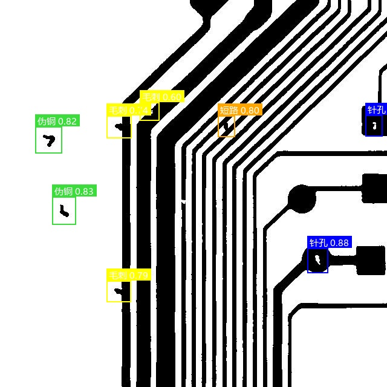
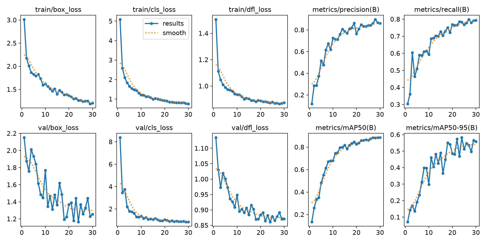
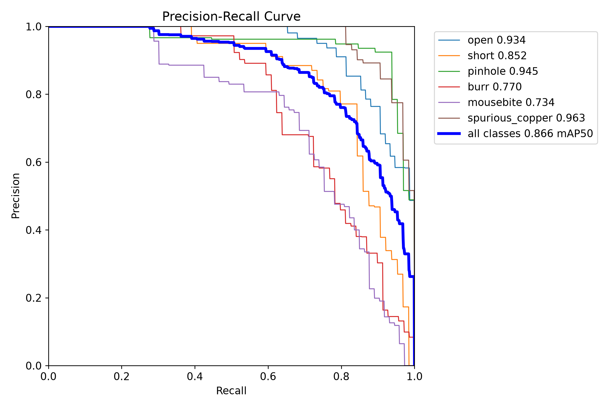
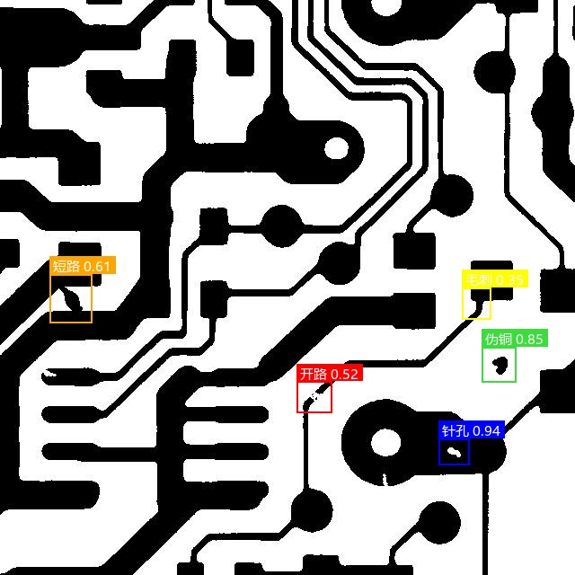

# 公众号文章｜PCB 电路板缺陷检测系统

> 以下为可直接粘贴到微信公众号编辑器的正文稿。标题备选与排版建议放在文末，不计入正文。

---

## 标题备选

1. 我用 YOLOv8 做了一套 PCB 缺陷检测系统：六类缺陷、批量检测、一键出报表
2. 从 0 到 1 搭建工业视觉质检系统：DeepPCB + YOLOv8 + PyQt5 全记录
3. 不依赖 GPU，也能跑通的 PCB 缺陷检测系统（附真实实验数据）

**封面文案建议**：主标题「PCB 缺陷检测系统」；副标题「YOLOv8 × DeepPCB × PyQt5」；背景使用 `images/detect_multi.jpg` 或 `images/detect_mousebite.jpg`。

**摘要（分享卡片文案）**：1500 张公开图像、10113 个缺陷标注、六类工业标准缺陷，一套能训练、能检测、能出报表的 PCB 质检系统。

---

## 正文

### 一块电路板上的“找茬题”

PCB 是电子设备的骨架。一块板子上，线路宽窄只有零点几毫米，蚀刻纹理密密麻麻。开路、短路、针孔、毛刺、鼠咬、伪铜——这六类缺陷一旦漏检，下游整机就可能失效。

传统产线靠人眼目检。问题很现实：盯着屏幕半小时之后，注意力下降，微小针孔和毛刺最容易被放过；不同班次的人判定尺度不一致；检完了也只留下一句“这块板不行”，没有可追溯的数据。

我们做的这件事，就是把这道“找茬题”交给模型：输入一张 PCB 图像，自动框出缺陷、标出类别和置信度，判定良品或不良品，并把统计结果导出成 Excel 报表。整套系统跑在本地 CPU 上，代码、数据和权重全部可复现。

### 它能做什么：六类缺陷 + 六个模块

系统面向工业 PCB 质检的完整业务流程，覆盖六个功能模块：

- **图像采集**：支持本地图片批量导入，兼容工业相机标准成像，也处理中文文件名路径。
- **图像预处理**：ROI 有效区域裁剪、高斯滤波降噪、亮度对比度均衡、尺寸归一化，界面里提供一键开关。
- **数据集构建**：基于公开数据集转换标注、LabelImg 校验互转、多维度增强、自动划分训练/验证/测试。
- **模型训练与调优**：YOLOv8n 迁移训练，调整学习率、批次、轮次，输出精准率、召回率、mAP 曲线。
- **智能推理检测**：识别缺陷、绘制彩色检测框、输出类别与置信度、自动判定 OK/NG、记录单张耗时。
- **统计与报表**：良品/不良品数量、六类缺陷频次、缺陷截图自动保存、一键导出 Excel 质检报表。

六个模块串成一条链：**输入 → 处理 → 判定 → 统计 → 归档**。桌面界面只是这条链的可视化入口，每个模块本身都可以单独复用。

### 数据从哪来：完全开源的 DeepPCB

项目用的是 GitHub 上 `tangsanli5201/DeepPCB` 开源数据集，没有工业保密、没有版权风险，非常适合毕设展示和实训教学。

数据集共 **1500 张 640×640 的 PCB 图像**、**10113 个标注框**，官方已经划分好 1000 张训练图和 500 张测试图。标注文件原本是空格分隔的文本，格式为「左上 x、左上 y、右下 x、右下 y、类别 ID」，需要转换成 YOLO 的归一化格式。

按项目要求，我们从官方训练集里为六类缺陷**各取 50 张**，取并集得到 300 张基础训练图，再通过翻转、亮度扰动、加噪、缩放做离线增强，扩展到 **1500 张**训练样本。验证集和测试集各 60 张，来自独立划分，不参与训练。

六类缺陷的映射关系如下：

| 中文名称 | 英文标签 | 原始类别 ID |
| --- | --- | --- |
| 开路 | open | 1 |
| 短路 | short | 2 |
| 针孔 | pinhole | 6 |
| 毛刺 | burr（原始 spur） | 4 |
| 鼠咬 | mousebite | 3 |
| 伪铜 | spurious_copper | 5 |

这里有个容易踩的坑：原始数据集把毛刺写作 spur、伪铜写作 copper，如果不在配置文件里显式对齐，论文、界面和评测会出现名称歧义。

### 预处理：四步，解决光照与纹理干扰

PCB 图像常见的问题是光照不均、蚀刻纹理干扰和成像噪点。系统设计了四步预处理：

1. **ROI 有效区域裁剪**：基于最大前景轮廓定位板面，保留 3% 边距，防止边缘缺陷被切掉。
2. **高斯滤波降噪**：抑制细小噪点与压缩伪影。
3. **LAB 空间 CLAHE 均衡**：改善反光与局部光照不均。
4. **等比缩放 + 补边归一化**：统一到模型输入尺寸，不拉伸变形。

调试时遇到过一个典型问题：初版按“前景面积占比”裁剪 ROI，结果把整板误判成了一条线路窄条。改成以最大轮廓为基准并保留边距后，输出才恢复完整板面。这件事的结论很朴素——**通用阈值不能照搬，必须用真实图像验证**。

### 训练：CPU 上跑完 30 轮

模型选择 YOLOv8n 轻量版，加载官方预训练权重做迁移训练。环境没有 GPU，所以配置上做了取舍：

| 参数 | 取值 |
| --- | --- |
| 输入尺寸 imgsz | 320 |
| 批次 batch | 16 |
| 训练轮次 epochs | 30（含早停，patience=12） |
| 初始学习率 lr0 | 0.01 |
| mosaic 增强概率 | 0.2 |
| CPU 线程 | 8 |

基准测试显示，480px 输入单轮约 2.5 分钟；320px + batch16 能在有限算力下完成多轮实验，也方便做阈值对比。整个训练约 18 分钟。

训练曲线显示：box/cls/dfl 三类损失在前 10 轮快速下降，precision、recall 和 mAP50 同步上升，20 轮后进入平台期，早停机制据此终止了冗余迭代。

### 真实成绩：测试集指标与阈值取舍

在独立测试集上，最终模型的指标为：

| 指标 | 数值 |
| --- | --- |
| 精确率 Precision | 0.893 |
| 召回率 Recall | 0.783 |
| mAP50 | 0.876 |
| mAP50-95 | 0.602 |

为了写论文实验，还固定 IOU=0.45，对比了不同置信度阈值：

| 置信度 | 精确率 | 召回率 | mAP50 |
| --- | --- | --- | --- |
| 0.25 | 0.860 | 0.818 | 0.805 |
| 0.35 | 0.868 | 0.805 | 0.780 |
| 0.50 | 0.927 | 0.744 | 0.723 |
| 0.65 | 0.959 | 0.589 | 0.578 |

规律很清晰：阈值从 0.25 提到 0.65，精确率上升约 9.5 个百分点，召回率下降约 23 个百分点。**阈值不是越高越好**——如果场景是“宁可错杀不可漏过”，就选低阈值；如果要减少复检工作量，就选高阈值。系统默认取 0.35，在两者之间取平衡。

### 六类缺陷，难度并不一样

验证集 PR 曲线给出了各类别的 AP：伪铜 0.963、针孔 0.945、开路 0.934、短路 0.852、毛刺 0.770、鼠咬 0.734，总体 mAP50 为 0.866。

伪铜和针孔形态规则、与背景对比明显，模型学得最好；毛刺和鼠咬边缘细碎、与线路纹理接近，是最难的两类。这也指明了后续优化方向：提高输入分辨率，针对小目标做定向增强。

### 界面与报表：从模型输出到质检记录

桌面端用 PyQt5 实现。窗口顶部是「上传图片(可多选)」「一键检测」「导出Excel报表」「清空历史」四个按钮，以及预处理开关和置信度调节。左侧上下显示原图与带框结果图，右侧上方是检测历史表格（序号、时间、来源、判定、置信度、缺陷数、耗时），下方是质检统计面板（良品/不良品/不良率/平均耗时 + 六类缺陷频次）。点击历史行可以回看当时的标注图。

Excel 报表包含三张工作表：检测明细、缺陷统计、质检汇总。每次批量检测的结果都会保存到历史记录，截图自动归档到输出目录。

工程上还修了两个实际问题：一是外部工具（比如 PyCharm）注入 Qt 插件环境变量会导致启动时报「no Qt platform plugin could be initialized」，现在在程序入口和启动脚本里都会强制清理并绑定当前解释器的插件目录；二是 OpenCV 默认读写不支持中文路径，已改用兼容方案。

### 检测效果：中文标签、彩色框、置信度

实际输出是带颜色的检测框，框上方直接显示中文类别和置信度，例如「伪铜 0.91」「短路 0.80」「针孔 0.88」。同一块板上可以同时框出多类缺陷，判定结果和耗时随记录一起保存。

### 局限与下一步

必须坦诚说明局限：CPU 训练采用 320px 输入，极小针孔和毛刺的定位精度受限；召回率 0.783 还有提升空间；数据集来自公开标准场景，没有覆盖真实产线的光照波动与遮挡。

下一步计划分三步走：先把 imgsz 提升到 480/640 并增加小目标增强，重点改善毛刺和鼠咬；再接入工业相机 SDK，增加缺陷分级与 SPC 统计；最后把推理部署到边缘设备，验证实时性。

### 写在最后

这套系统的价值不在于模型有多复杂，而在于它把**数据、训练、推理、统计、交付**串成了一条完整链路：完全开源的数据集、成熟稳定的 YOLOv8、可复现的实验数据、能实际点开的桌面界面，以及一键导出的质检报表。

对于计算机专业毕设，它难度适中、代码成熟、展示效果好；对于机器视觉实训，它贴近工业质检的真实业务流程。项目已上传 GitHub：`sixpencecn/PCB-Defect-Detection-YOLOv8`，欢迎交流。

如果你也在做视觉检测相关的毕设，或者对阈值实验、数据增强有疑问，欢迎在评论区留言。

---

## 排版与发布建议

- **封面图**：使用 `images/detect_mousebite.jpg`，裁成 2.35:1，主体检测框居中。
- **正文字号**：15px，行距 1.75，段间距 12px；标题 18px 加粗，二级标题可用主色。
- **配图位置**：共 4 张图，分别放在「导语后」「训练章节」「PR 曲线章节」「检测效果章节」，图片下方加 13px 灰色图注。
- **表格**：建议把本文的 Markdown 表格转为公众号原生表格；如编辑器不便，可截图插入，但保留文字数据用于检索。
- **摘要与关键词**：摘要用上文分享卡片文案；关键词：YOLOv8、PCB 缺陷检测、DeepPCB、机器视觉、毕业设计。
- **字数**：正文约 3300 字，阅读时间约 8 分钟。
